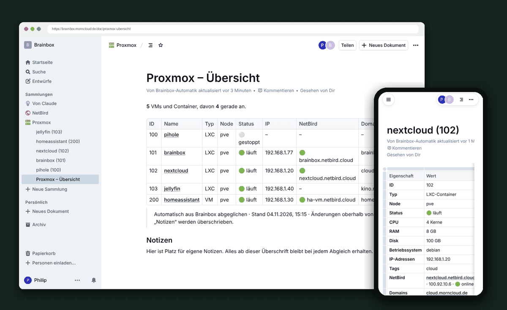
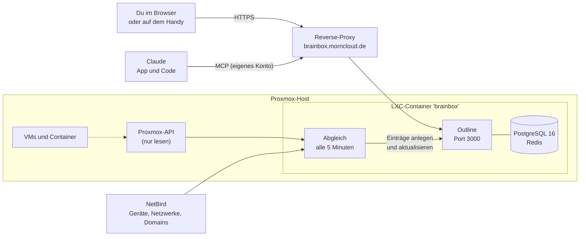
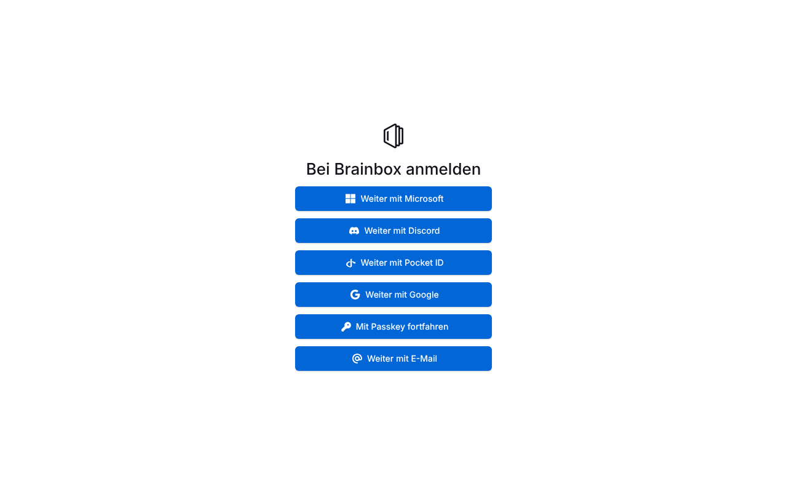
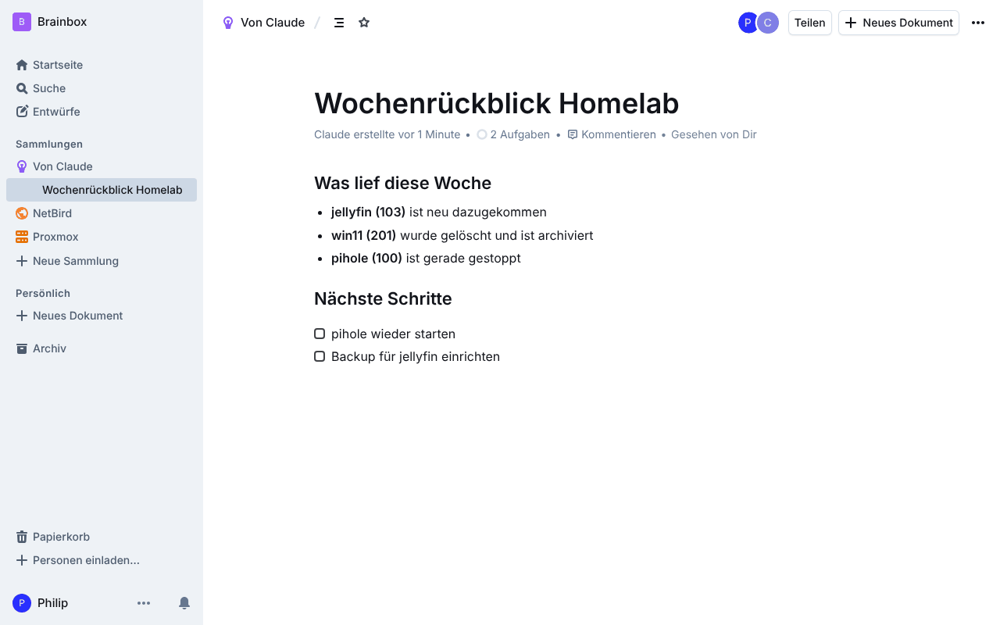
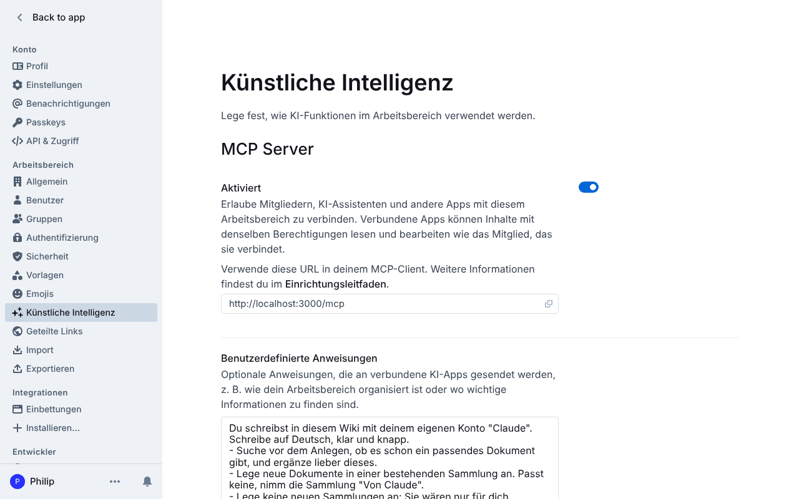
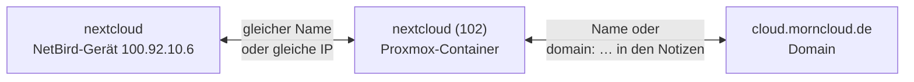
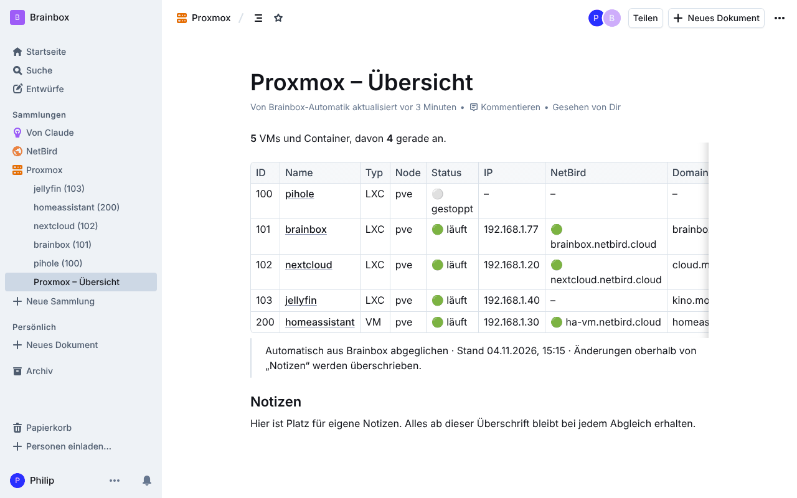
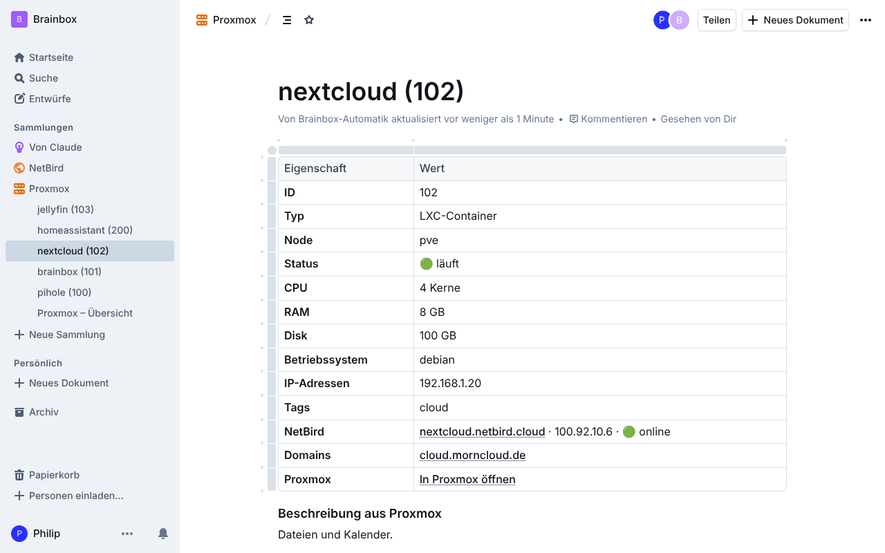
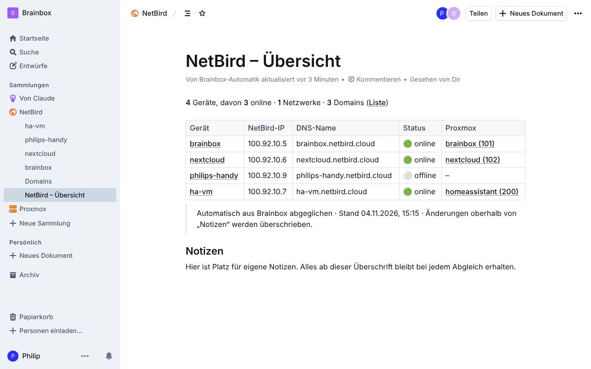
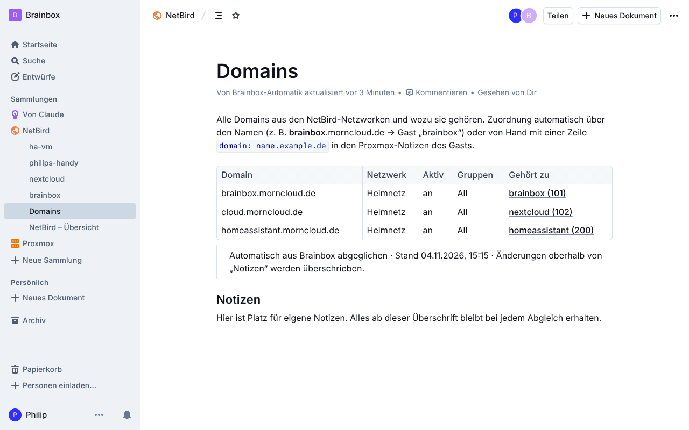

<p align="center"></p>

<p align="center">
  <a href="LICENSE"></a>
  
  
  <a href="https://github.com/outline/outline/releases"></a>
  
  
</p>

<p align="center"><b>Dein Wiki fürs Homelab.</b> Ein Befehl in der Proxmox-Shell, und es steht: auf Deutsch, mit Login-Link für dich,<br>jede VM und jedes NetBird-Gerät automatisch drin, und Claude schreibt mit eigenem Konto mit.</p>

<p align="center">
  <a href="#-schnellstart">Schnellstart</a> ·
  <a href="#-was-drin-ist">Funktionen</a> ·
  <a href="#-anmelden">Anmelden</a> ·
  <a href="#-claude-verbinden">Claude</a> ·
  <a href="#%EF%B8%8F-proxmox-und-netbird-im-wiki">Proxmox &amp; NetBird</a> ·
  <a href="docs/proxmox-quickstart.md">Quick-Start-Guide</a>
</p>

<p align="center"></p>

---

## ✨ Was drin ist

| | |
|---|---|
| 🚀 **Ein Befehl** | Legt auf dem Proxmox einen Debian-13-Container an und installiert die Wissensdatenbank [Outline](https://www.getoutline.com) mit Node.js 26, PostgreSQL 16 und Redis. |
| 📚 **Ein Container = ein Wiki** | Wiki-Name, Domain und Admin werden bei der Installation abgefragt und angelegt. Am Ende gibt es einen Login-Link. Weiteres Wiki: Befehl nochmal, andere Domain. |
| 🔑 **Sechs Wege zum Anmelden** | E-Mail-Link, Passkey, Google, Microsoft, Discord und eigene Login-Dienste wie Pocket ID. Eingerichtet per Menü mit `brainbox-login`. |
| 🤖 **Claude schreibt mit** | Claude bekommt ein eigenes Konto und verbindet sich über den eingebauten MCP-Anschluss, in der Claude-App wie in Claude Code. |
| 🖥️ **Proxmox im Wiki** | Jede VM und jeder Container bekommt einen eigenen Eintrag. Neue erscheinen nach spätestens 5 Minuten, gelöschte werden archiviert. |
| 🌐 **NetBird im Wiki** | Geräte, Netzwerke und Domains aus NetBird, automatisch mit den passenden VMs verknüpft. |
| 📝 **Deine Notizen bleiben** | Alles unter der Überschrift „Notizen“ gehört dir. Der Abgleich ändert nur den Teil darüber. |
| 🔒 **Nur mit Einladung** | Rein kommt nur, wen du einlädst. Proxmox wird nur gelesen. Schlüssel liegen geschützt im Container. |
| 🔄 **Update mit Rückweg** | `update` sichert Datenbank und Einstellungen, baut die neue Version und spielt bei Fehlern die alte zurück. |
| 🇩🇪 **Auf Deutsch** | Oberfläche, Menüs, Meldungen und Anleitungen. |

## 🚀 Schnellstart

### 1. Installieren

In der **Proxmox-Shell** (auf dem Host, nicht in einem Container):

```bash
bash -c "$(curl -fsSL https://raw.githubusercontent.com/pmornhart/Brainbox/main/proxmox/brainbox.sh)"
```

Das Skript fragt nacheinander:

| Frage | Beispiel |
|---|---|
| Standard oder Erweitert | Standard: 2 Kerne, 4 GB RAM, 8 GB Disk, Debian 13 |
| Name des Wikis | `Brainbox` |
| Domain | `brainbox.morncloud.de` (leer = nur im Heimnetz über `http://IP:3000`) |
| Dein Name und deine E-Mail | du wirst Admin des Wikis |
| Proxmox im Wiki? | Ja: jede VM und jeder Container bekommt einen Eintrag |

Die Installation dauert 10 bis 20 Minuten. Am Ende siehst du Adresse und Login-Link:

```text
  ✔️  Fertig!
  💡  Wiki 'Brainbox' wurde eingerichtet.
  💡  Adresse: https://brainbox.morncloud.de   (im Heimnetz: http://192.168.1.77:3000)
  💡  Reverse-Proxy einrichten: brainbox.morncloud.de → http://192.168.1.77:3000  (Websockets an, SSL-Zertifikat)
  💡  Dein Login-Link (einmal benutzbar, 60 Minuten gültig):
        https://brainbox.morncloud.de/auth/redirect?token=eyJhbGci…
```

### 2. Domain freischalten

Im Reverse-Proxy (z. B. Nginx Proxy Manager) einen Eintrag anlegen: `brainbox.morncloud.de` → `http://<IP des Containers>:3000`, **Websockets an**, SSL-Zertifikat von Let's Encrypt.

### 3. Login-Link anklicken

Du bist als Admin drin. Danach am besten gleich einen **Passkey** anlegen (Profil → Einstellungen → Passkeys). Link abgelaufen? Im Container `brainbox-login link`.

> Ausführliche Anleitung mit allen Optionen: **[Proxmox Quick-Start-Guide](docs/proxmox-quickstart.md)**

## 🧭 So hängt alles zusammen



## 🔑 Anmelden



Im Container `brainbox-login` eingeben. Das Menü richtet die Adresse, den E-Mail-Versand (mit Vorlagen für Gmail, GMX, web.de, Outlook, IONOS, Strato und Test-Mail), Google, Microsoft, Discord, eigene Login-Dienste und die Sprache ein.

| Weg | Wer | Braucht |
|---|---|---|
| Login-Link | du als Admin | nichts, kommt aus der Installation |
| E-Mail | alle Eingeladenen | Postfach mit App-Passwort |
| Passkey | wer einen angelegt hat | HTTPS mit Domain |
| Google | eingeladene Google-Konten | HTTPS, OAuth-Client bei Google |
| Microsoft | Firmen- und Schulkonten | HTTPS, App bei Microsoft Entra |
| Discord | eingeladene Discord-Konten | HTTPS, App bei Discord |
| OIDC | Konten in Pocket ID, Authentik … | den Login-Dienst |

<br clear="right">

## 🤖 Claude verbinden

Claude bekommt ein **eigenes Konto** im Wiki. So siehst du immer, was von dir und was von Claude ist, und kannst Claude jederzeit sperren.

```bash
brainbox-connect claude
```

Das legt das Konto „Claude“ und die gemeinsame Sammlung **„Von Claude“** an, erstellt einen Schlüssel und hinterlegt im Wiki eine Anweisung für Claude: auf Deutsch schreiben, erst suchen, dann ergänzen, keine Passwörter. Danach zeigt es dir beide Wege:

- **Claude-App** (claude.ai, Handy, Desktop): Einstellungen → Connectors → Benutzerdefinierten Connector hinzufügen → `https://brainbox.morncloud.de/mcp` → im Anmeldefenster als Claude zulassen
- **Claude Code**: `claude mcp add --transport http brainbox https://brainbox.morncloud.de/mcp --header "Authorization: Bearer …"`

<table>
  <tr>
    <td width="50%"></td>
    <td width="50%"></td>
  </tr>
  <tr>
    <td align="center"><sub>Von Claude geschrieben: „Claude erstellte …“</sub></td>
    <td align="center"><sub>MCP-Adresse und Anweisung für Claude</sub></td>
  </tr>
</table>

## 🖥️ Proxmox und NetBird im Wiki

```bash
brainbox-connect proxmox    # bei der Installation schon erledigt, wenn du "Ja" gewählt hast
brainbox-connect netbird    # NetBird-API-Adresse und Access Token
```

Alle 5 Minuten gleicht Brainbox ab. Jede VM, jeder Container und jedes NetBird-Gerät bekommt einen eigenen Eintrag mit Status, CPU, RAM, Disk, IP-Adressen, Tags, Beschreibung und einem Link zurück zu Proxmox. Was zusammengehört, wird verknüpft:



<table>
  <tr>
    <td width="50%"></td>
    <td width="50%"></td>
  </tr>
  <tr>
    <td align="center"><sub>Übersicht aller VMs und Container</sub></td>
    <td align="center"><sub>Ein Container mit NetBird-Gerät und Domain</sub></td>
  </tr>
  <tr>
    <td></td>
    <td></td>
  </tr>
  <tr>
    <td align="center"><sub>NetBird-Geräte, online/offline, mit Proxmox verknüpft</sub></td>
    <td align="center"><sub>Domains und wozu sie gehören</sub></td>
  </tr>
</table>

- **Neue VM:** erscheint nach spätestens 5 Minuten im Wiki.
- **Gelöschte VM:** Eintrag wird archiviert, nicht gelöscht. Kommt sie zurück, wird er wiederhergestellt.
- **Deine Notizen:** Alles ab der Überschrift „Notizen“ bleibt bei jedem Abgleich erhalten.
- **Domain von Hand zuordnen:** in Proxmox in die Notizen des Gasts eine Zeile `domain: kino.morncloud.de` schreiben.

## 📚 Mehrere Wikis

Ein Container ist ein großes Wiki. Für ein weiteres (z. B. für die Werkstatt oder die Familie) den Installationsbefehl nochmal ausführen und eine andere Domain eintragen, etwa `werkstatt.morncloud.de`. Jedes Wiki hat eigene Nutzer, eigene Anmeldewege, eigene Updates und auf Wunsch einen eigenen Proxmox-Zugang.

## 🔄 Update

Im Container:

```bash
update
```

Sichert Datenbank und Einstellungen nach `/root/brainbox-backups/`, holt die neueste Outline-Version, baut sie und startet neu. Geht etwas schief, läuft automatisch wieder die alte Version. `update --check` prüft nur, `update --force` baut neu. Die Brainbox-Befehle aktualisieren sich dabei selbst.

## 🧰 Befehle im Container

| Befehl | Wofür |
|---|---|
| `brainbox-login` | Anmeldewege einrichten (Menü) |
| `brainbox-login link [E-Mail]` | einmaliger Login-Link, 60 Minuten gültig |
| `brainbox-login status` | Übersicht über Adresse, Zugang und Anmeldewege |
| `brainbox-connect` | Claude, Proxmox und NetBird verbinden (Menü) |
| `brainbox-connect sync` | sofort abgleichen statt in 5 Minuten |
| `brainbox-connect status` | was verbunden ist, wann zuletzt abgeglichen |
| `update` | Outline und Brainbox aktualisieren |

<details>
<summary><b>Wichtige Pfade</b></summary>

| Was | Wo |
|---|---|
| Outline | `/opt/brainbox` |
| Einstellungen von Outline | `/opt/brainbox/.env` (danach `systemctl restart brainbox`) |
| Verbindungen (Schlüssel, Tokens) | `/etc/brainbox/connect.env` (nur für root lesbar) |
| Abgleich-Programm und Zustand | `/opt/brainbox-connect/sync.mjs`, `/var/lib/brainbox-connect/state.json` |
| Hochgeladene Dateien | `/var/lib/outline/data` |
| Datenbank-Zugang | `/root/brainbox.creds` |
| Sicherungen vom Update | `/root/brainbox-backups/` |
| Logs | `journalctl -u brainbox -f`, `journalctl -u brainbox-sync` |

</details>

## 🔒 Sicherheit

- **Nur Eingeladene kommen rein.** Die Installation schaltet „Einladungen erforderlich“ ein. Sonst könnte sich bei eingeschaltetem Google- oder Microsoft-Login jedes beliebige Konto selbst anmelden.
- **Proxmox wird nur gelesen.** Der Zugang `brainbox@pve` hat die Rolle PVEAuditor und einen eigenen Token je Wiki.
- **Login-Links** gelten einmal und 60 Minuten.
- **Schlüssel und Tokens** liegen in `/etc/brainbox/connect.env`, nur für root lesbar, und landen nie im Wiki.
- **Claude** arbeitet mit eigenem Konto und den Rechten eines Mitglieds. Sperren unter Einstellungen → Benutzer.

## ❓ Häufige Fragen

<details>
<summary>Kann ich mich mit einem privaten Outlook- oder Hotmail-Konto anmelden?</summary>

Über den Microsoft-Knopf nicht: Outline braucht dafür ein Firmen- oder Schulkonto (Microsoft 365 / Entra ID). Private Konten nehmen den E-Mail-Link oder einen Passkey.
</details>

<details>
<summary>Warum gehen Passkeys nicht über die IP-Adresse?</summary>

Browser erlauben Passkeys nur über HTTPS mit einer Domain. Im Heimnetz über `http://IP:3000` geht der Login-Link, für Passkeys braucht es die Domain mit Zertifikat.
</details>

<details>
<summary>Ich habe keinen Reverse-Proxy. Geht es trotzdem?</summary>

Ja, im Heimnetz: Bei der Installation die Domain leer lassen, dann läuft das Wiki unter `http://IP:3000`. Für Passkeys, Google, Microsoft und die Claude-App braucht es später eine Domain mit HTTPS.
</details>

<details>
<summary>Wie lösche ich ein Wiki?</summary>

Den Container in Proxmox löschen. Falls „Proxmox im Wiki“ an war, zusätzlich den Token entfernen: `pveum user token remove brainbox@pve wiki<ID>`.
</details>

<details>
<summary>Geht es auch ohne Proxmox?</summary>

Ja, auf einem frischen Debian 13 als root:

```bash
bash -c "$(curl -fsSL https://raw.githubusercontent.com/pmornhart/Brainbox/main/install.sh)"
```
</details>

## 🙏 Herkunft

Nachbau von [`ct/outline.sh`](https://github.com/community-scripts/ProxmoxVE/blob/main/ct/outline.sh) und [`install/outline-install.sh`](https://github.com/community-scripts/ProxmoxVE/blob/main/install/outline-install.sh) aus den [Proxmox VE Helper-Scripts](https://community-scripts.org/scripts/outline) (MIT, Autor: tremor021), ohne Abhängigkeit vom community-scripts-Framework, erweitert um automatisches Wiki, Anmeldewege, Claude, Proxmox und NetBird. Outline selbst: [outline/outline](https://github.com/outline/outline) (BSL 1.1).

---

<sub>Verfasst mit Claude 🤖</sub>
