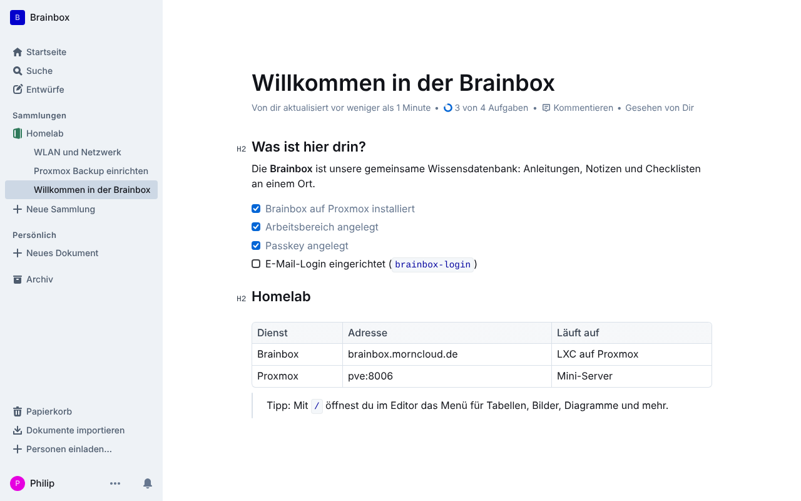
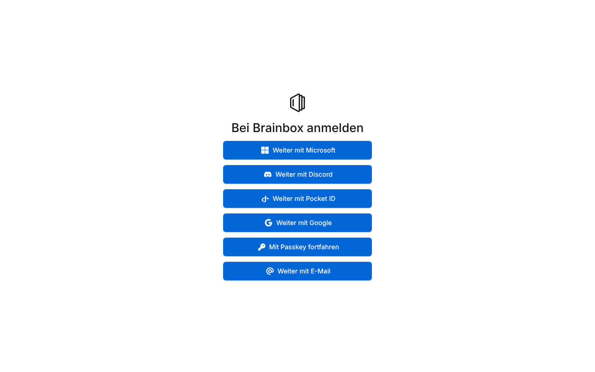

<p align="center"></p>

<p align="center">
  <a href="LICENSE"></a>
  
  
  <a href="https://github.com/outline/outline/releases"></a>
</p>

# 🧠 Brainbox

Die Wissensdatenbank [Outline](https://www.getoutline.com) mit einem Befehl als LXC-Container auf Proxmox VE: Nachbau des [community-scripts Outline-Skripts](https://community-scripts.org/scripts/outline).

<p align="center"></p>

## Funktionen

- 🚀 **Ein Einzeiler** in der Proxmox-Shell legt den Container an und installiert alles
- ⚙️ **Standard oder Erweitert**: Dialog für ID, Hostname, CPU, RAM, Disk, Netzwerk, VLAN, Passwort
- 📚 **Outline** aus dem neuesten offiziellen Release, mit Node.js 26, PostgreSQL 16 und Redis
- 📚 **Ein Container = ein Wiki**: Wiki-Name, Domain und Admin werden bei der Installation abgefragt und automatisch angelegt
- 🔗 **Login-Link** am Ende der Installation, neuer Link jederzeit mit `brainbox-login link`
- 🌐 **Mehrere Wikis**: Skript erneut ausführen, andere Domain eintragen
- 🔑 **Sechs Anmeldewege**: E-Mail-Link, Passkey, Google, Microsoft, Discord, OIDC (z. B. Pocket ID), alles per Menü mit `brainbox-login`
- 🇩🇪 **Oberfläche auf Deutsch**
- 🔄 **`update`-Befehl** im Container: sichert vorher Datenbank und Einstellungen, spielt bei Fehlern die alte Version zurück
- 🧩 Läuft unprivilegiert, startet mit Proxmox, Notizen mit Link in der Proxmox-Oberfläche

## Installation

In der **Proxmox-Shell** (Host):

```bash
bash -c "$(curl -fsSL https://raw.githubusercontent.com/pmornhart/Brainbox/main/proxmox/brainbox.sh)"
```

| CPU | RAM | Disk | System | Port |
|---|---|---|---|---|
| 2 Kerne | 4096 MB | 8 GB | Debian 13 | 3000 |

Das Skript fragt **Wiki-Name, Domain (z. B. `brainbox.morncloud.de`), deinen Namen und deine E-Mail** ab, legt das Wiki an und zeigt am Ende einen **Login-Link** (einmal benutzbar, 60 Minuten gültig). Mit Domain muss vorher der Reverse-Proxy stehen: Domain → `http://<IP>:3000`, Websockets an, SSL.

Alle Details, Pfade und Optionen: **[Proxmox Quick-Start](docs/proxmox-quickstart.md)**.

## Anmeldung einrichten

<p align="center"></p>

Im Container `brainbox-login` eingeben. Ein Menü richtet Adresse (Domain/HTTPS), E-Mail-Versand, Passkeys, Google, Microsoft, Discord, OIDC und Sprache ein und startet Brainbox danach neu.

| Weg | Wer | Braucht |
|---|---|---|
| E-Mail-Link / Code | alle Eingeladenen | Postfach zum Versenden (SMTP), z. B. Gmail mit App-Passwort |
| Passkey | wer in den Einstellungen einen angelegt hat | HTTPS mit Domain |
| Google | Google-Konten (private @gmail.com nur zum Beitreten) | HTTPS mit Domain, OAuth-Client in der Google Cloud Console |
| Microsoft | Firmen- und Schulkonten (Microsoft 365 / Entra ID) | HTTPS mit Domain, App-Registrierung in Microsoft Entra |
| Discord | Discord-Konten, optional nur Mitglieder eines Servers | HTTPS mit Domain, App im Discord Developer Portal |
| OIDC | Konten im eigenen Login-Dienst (Pocket ID, Authentik, Keycloak …) | den Login-Dienst |

Für den ersten Login brauchst du nichts davon: Der Login-Link aus der Installation reicht. Danach am besten gleich einen Passkey anlegen (Profil → Einstellungen → Passkeys).

## Mehrere Wikis

Ein Container ist ein großes Wiki. Für ein weiteres Wiki das Skript einfach noch einmal ausführen und eine andere Domain eintragen, z. B. `werkstatt.morncloud.de`. Jedes Wiki hat eigene Nutzer, eigene Anmeldewege und eigene Updates.

## Bedienung

| Was | Wo |
|---|---|
| Anmeldung einrichten | `brainbox-login` (Übersicht: `brainbox-login status`) |
| Neuer Login-Link | `brainbox-login link` (für andere: `brainbox-login link name@example.de`) |
| Einstellungen | `/opt/brainbox/.env` (danach `systemctl restart brainbox`) |
| Logs | `journalctl -u brainbox -f` |
| Datenbank-Zugang | `/root/brainbox.creds` |
| Sicherungen vom Update | `/root/brainbox-backups/` |

## Update

Im Container:

```bash
update
```

`update --check` prüft nur, `update --force` baut auch bei gleicher Version neu. Das Skript holt sich vorher selbst in der neuesten Version aus diesem Repo.

## Ohne Proxmox

Auf einem frischen Debian 13 (LXC, VM oder Server) als root:

```bash
bash -c "$(curl -fsSL https://raw.githubusercontent.com/pmornhart/Brainbox/main/install.sh)"
```

## Herkunft

Nachbau von [`ct/outline.sh`](https://github.com/community-scripts/ProxmoxVE/blob/main/ct/outline.sh) und [`install/outline-install.sh`](https://github.com/community-scripts/ProxmoxVE/blob/main/install/outline-install.sh) aus den Proxmox VE Helper-Scripts (MIT, Autor: tremor021), ohne Abhängigkeit vom community-scripts-Framework. Outline selbst: [outline/outline](https://github.com/outline/outline) (BSL 1.1).

---

<sub>Verfasst mit Claude 🤖</sub>
