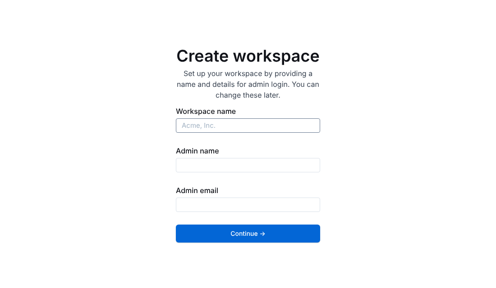

<p align="center"></p>

<p align="center">
  <a href="LICENSE"></a>
  
  
  <a href="https://github.com/outline/outline/releases"></a>
</p>

# 🧠 Brainbox

Die Wissensdatenbank [Outline](https://www.getoutline.com) mit einem Befehl als LXC-Container auf Proxmox VE: Nachbau des [community-scripts Outline-Skripts](https://community-scripts.org/scripts/outline).

<p align="center"></p>

## Funktionen

- 🚀 **Ein Einzeiler** in der Proxmox-Shell legt den Container an und installiert alles
- ⚙️ **Standard oder Erweitert**: Dialog für ID, Hostname, CPU, RAM, Disk, Netzwerk, VLAN, Passwort
- 📚 **Outline** aus dem neuesten offiziellen Release, mit Node.js 26, PostgreSQL 16 und Redis
- 🔐 **Erster Start ohne Fremd-Login**: Workspace und Admin direkt im Browser anlegen
- 🔄 **`update`-Befehl** im Container: sichert vorher Datenbank und Einstellungen, spielt bei Fehlern die alte Version zurück
- 🧩 Läuft unprivilegiert, startet mit Proxmox, Notizen mit Link in der Proxmox-Oberfläche

## Installation

In der **Proxmox-Shell** (Host):

```bash
bash -c "$(curl -fsSL https://raw.githubusercontent.com/pmornhart/Brainbox/main/proxmox/brainbox.sh)"
```

| CPU | RAM | Disk | System | Port |
|---|---|---|---|---|
| 2 Kerne | 4096 MB | 8 GB | Debian 13 | 3000 |

Danach im Browser `http://<IP>:3000` öffnen, Workspace-Name, Name und E-Mail eingeben, fertig. Beim allerersten Start migriert Outline die Datenbank, das dauert ein bis zwei Minuten.

Alle Details, Pfade und Optionen: **[Proxmox Quick-Start](docs/proxmox-quickstart.md)**.

## Bedienung

| Was | Wo |
|---|---|
| Einstellungen | `/opt/brainbox/.env` (danach `systemctl restart brainbox`) |
| Logs | `journalctl -u brainbox -f` |
| Datenbank-Zugang | `/root/brainbox.creds` |
| Sicherungen vom Update | `/root/brainbox-backups/` |

## Update

Im Container:

```bash
update
```

`update --check` prüft nur, `update --force` baut auch bei gleicher Version neu. Das Skript holt sich vorher selbst in der neuesten Version aus diesem Repo.

## Ohne Proxmox

Auf einem frischen Debian 13 (LXC, VM oder Server) als root:

```bash
bash -c "$(curl -fsSL https://raw.githubusercontent.com/pmornhart/Brainbox/main/install.sh)"
```

## Herkunft

Nachbau von [`ct/outline.sh`](https://github.com/community-scripts/ProxmoxVE/blob/main/ct/outline.sh) und [`install/outline-install.sh`](https://github.com/community-scripts/ProxmoxVE/blob/main/install/outline-install.sh) aus den Proxmox VE Helper-Scripts (MIT, Autor: tremor021), ohne Abhängigkeit vom community-scripts-Framework. Outline selbst: [outline/outline](https://github.com/outline/outline) (BSL 1.1).

---

<sub>Verfasst mit Claude 🤖</sub>
