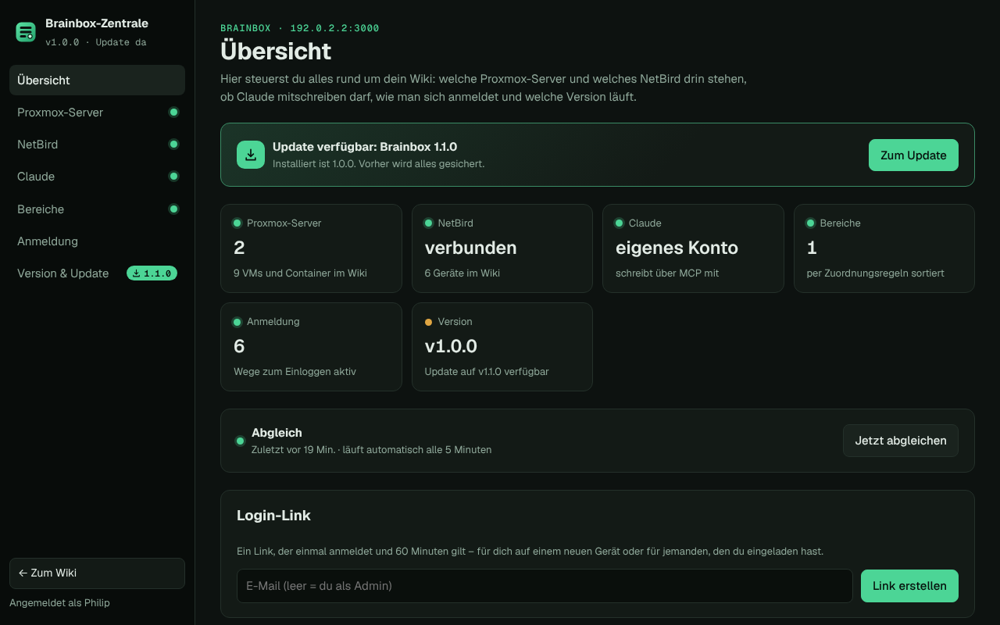
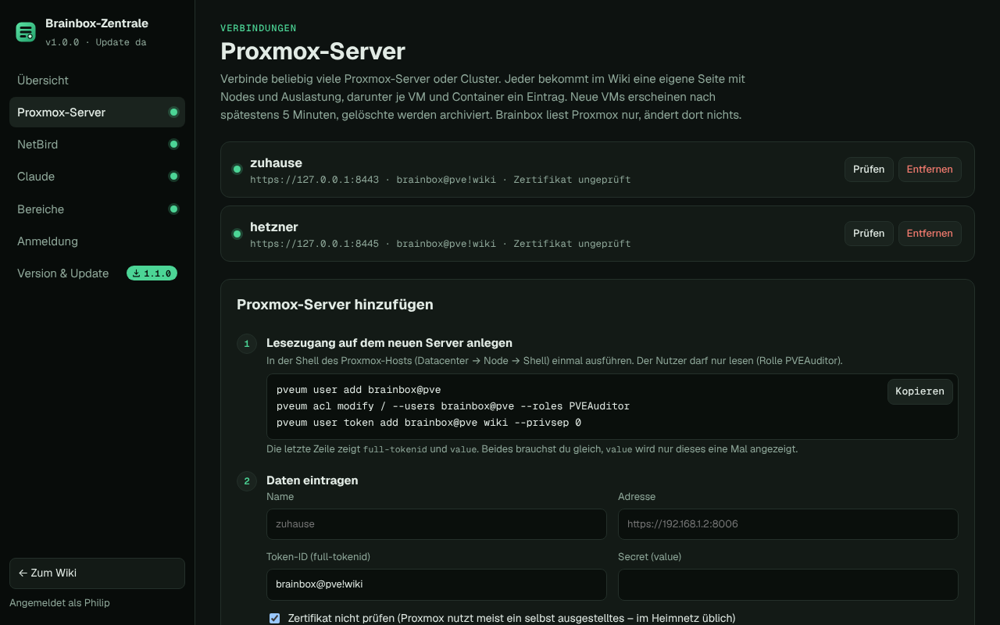
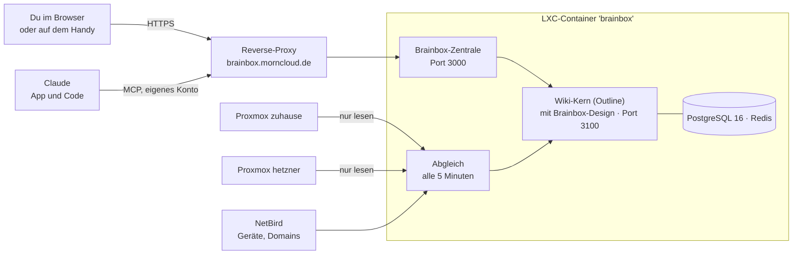

<p align="center"></p>

<p align="center">
  <a href="CHANGELOG.md"></a>
  
  
  
  <a href="LICENSE"></a>
</p>

<p align="center"><b>Dein Wiki fürs Homelab.</b> Ein Befehl in der Proxmox-Shell, und es steht – mit eigenem Gesicht, Login-Link,<br>allen Proxmox-Servern und NetBird automatisch drin, nach Bereichen sortiert, und Claude schreibt mit.</p>

<p align="center">
  <a href="#-schnellstart">Schnellstart</a> ·
  <a href="#%EF%B8%8F-brainbox-zentrale">Zentrale</a> ·
  <a href="#%EF%B8%8F-proxmox-server">Proxmox</a> ·
  <a href="#-netbird">NetBird</a> ·
  <a href="#%EF%B8%8F-bereiche">Bereiche</a> ·
  <a href="#-claude">Claude</a> ·
  <a href="#-anmelden">Anmelden</a> ·
  <a href="docs/proxmox-quickstart.md">Quick-Start-Guide</a>
</p>

<p align="center"></p>

---

## ✨ Was Brainbox ist

Brainbox ist ein eigenständiges Wiki für dein Homelab. Im Kern arbeitet [Outline](https://www.getoutline.com) – Editor, Echtzeit-Bearbeitung, Suche. Alles drumherum ist Brainbox: Name, Logo, Aussehen, Versionen, die Zentrale, die Verbindungen zu Proxmox, NetBird und Claude.

| | |
|---|---|
| 🎨 **Eigenes Gesicht** | Brainbox-Logo, eigener Name, Schrift Geist und das Farbschema „Homelab-Konsole“ – dunkel als Standard, hell auf Wunsch. |
| ⚙️ **Brainbox-Zentrale** | Alle Einstellungen im Browser, unten in der Seitenleiste: Proxmox-Server, NetBird, Claude, Bereiche, Anmeldung, Version und Update. Jeder Bereich erklärt Schritt für Schritt, was zu tun ist. |
| 🖥️ **Beliebig viele Proxmox-Server** | Jeder Server bekommt eine eigene Seite mit Nodes und Auslastung, darunter je VM und Container ein Eintrag. Neue erscheinen nach spätestens 5 Minuten. |
| 🌐 **NetBird** | Geräte, Netzwerke und Domains, automatisch mit den passenden VMs verknüpft. |
| 🗂️ **Bereiche** | Regeln wie `*.morninghosting.de → Minecraft-Server` sortieren Domains, VMs und Geräte, mit Unterbereichen. |
| 🤖 **Claude schreibt mit** | Eigenes Konto „Claude“ über den MCP-Anschluss, in der Claude-App wie in Claude Code. |
| 📚 **Ein Container = ein Wiki** | Wiki und Admin legt die Installation an, am Ende gibt es einen Login-Link. Weiteres Wiki: Befehl nochmal, andere Domain. |
| 🔑 **Sechs Wege zum Anmelden** | E-Mail-Link, Passkey, Google, Microsoft, Discord, eigener Login-Dienst. Rein kommt nur, wer eingeladen ist. |
| 🏷️ **Eigene Versionen** | Brainbox 1.0.0 mit fest getestetem Kern. Neue Versionen zeigt ein Update-Symbol im Wiki an. `update` sichert vorher alles und kehrt bei Fehlern zur alten Version zurück. |
| 🇩🇪 **Auf Deutsch** | Oberfläche, Zentrale, Befehle und Anleitungen. |

## 🚀 Schnellstart

### 1. Installieren

In der **Proxmox-Shell** (auf dem Host, nicht in einem Container):

```bash
bash -c "$(curl -fsSL https://raw.githubusercontent.com/pmornhart/Brainbox/main/proxmox/brainbox.sh)"
```

Das Skript fragt nacheinander:

| Frage | Beispiel |
|---|---|
| Standard oder Erweitert | Standard: 2 Kerne, 4 GB RAM, 8 GB Disk, Debian 13 |
| Name des Wikis | `Brainbox` |
| Domain | `brainbox.morncloud.de` (leer = nur im Heimnetz über `http://IP:3000`) |
| Dein Name und deine E-Mail | du wirst Admin |
| Proxmox im Wiki? | Ja: Lesezugang wird angelegt, dieser Server ist sofort verbunden |

Nach 10 bis 20 Minuten steht am Ende:

```text
  ✔️  Brainbox 1.0.0 ist installiert!
  💡  Adresse: https://brainbox.morncloud.de   (im Heimnetz: http://192.168.1.77:3000)
  💡  Brainbox-Zentrale: https://brainbox.morncloud.de/zentrale
  💡  Reverse-Proxy einrichten: brainbox.morncloud.de → http://192.168.1.77:3000  (Websockets an, SSL-Zertifikat)
  💡  Dein Login-Link (einmal benutzbar, 60 Minuten gültig):
        https://brainbox.morncloud.de/auth/redirect?token=eyJhbGci…
```

### 2. Domain freischalten

Im Reverse-Proxy (z. B. Nginx Proxy Manager): `brainbox.morncloud.de` → `http://<IP des Containers>:3000`, **Websockets an**, SSL-Zertifikat von Let's Encrypt.

### 3. Login-Link anklicken

Du bist als Admin drin. Unten in der Seitenleiste findest du die **Brainbox-Zentrale** – dort verbindest du weitere Proxmox-Server, NetBird und Claude.

> Ausführlich, mit allen Optionen: **[Proxmox Quick-Start-Guide](docs/proxmox-quickstart.md)**

## ⚙️ Brainbox-Zentrale

Unter `/zentrale`, unten in der Seitenleiste als „Brainbox-Zentrale“. Nur Admins kommen hinein.

<table>
  <tr>
    <td width="50%"></td>
    <td width="50%"></td>
  </tr>
  <tr>
    <td align="center"><sub>Übersicht: alles auf einen Blick, letzter Abgleich, Login-Link erstellen</sub></td>
    <td align="center"><sub>Proxmox-Server: verbundene Server, „Prüfen“, „Entfernen“, neuen hinzufügen</sub></td>
  </tr>
</table>

| Bereich | Was du dort machst |
|---|---|
| **Übersicht** | Status aller Verbindungen, jetzt abgleichen, Login-Link für dich oder Eingeladene |
| **Proxmox-Server** | beliebig viele Server verbinden, prüfen, entfernen – mit kopierbaren Befehlen für den Lesezugang |
| **NetBird** | API-Adresse und Token eintragen, trennen |
| **Claude** | Konto einrichten, Schlüssel und fertige Anleitung für App und Code |
| **Bereiche** | erklärt die Zuordnungsregeln, öffnet die Regel-Seite im Wiki |
| **Anmeldung** | E-Mail-Postfach, Google, Microsoft, Discord, eigener Login-Dienst – mit Redirect-URIs zum Kopieren |
| **Version & Update** | Brainbox-Version und Kern, nach Updates suchen, Update starten, Protokoll |

Alles geht auch im Terminal des Containers: `brainbox-connect`, `brainbox-login`, `update`.

## 🖥️ Proxmox-Server

Beliebig viele Server oder Cluster – zu Hause, im Keller, bei Hetzner. Jeder bekommt im Wiki eine eigene Seite mit Nodes, CPU, RAM und Laufzeit, darunter je VM und Container ein Eintrag mit Status, Ressourcen, IP-Adressen, Tags, NetBird-Gerät, Domains, Bereich und Link zurück zu Proxmox.

**Neuen Server verbinden** – in der Zentrale unter *Proxmox-Server* oder im Terminal:

```bash
# 1. auf dem neuen Proxmox-Host: Lesezugang anlegen (Rolle PVEAuditor)
pveum user add brainbox@pve
pveum acl modify / --users brainbox@pve --roles PVEAuditor
pveum user token add brainbox@pve wiki --privsep 0

# 2. im Brainbox-Container: verbinden
brainbox-connect proxmox add hetzner https://203.0.113.10:8006 'brainbox@pve!wiki' <value> --insecure
```

<table>
  <tr>
    <td width="50%"></td>
    <td width="50%"></td>
  </tr>
  <tr>
    <td align="center"><sub>Server-Seite: Nodes, Auslastung, alle VMs und Container</sub></td>
    <td align="center"><sub>Ein Container mit NetBird-Gerät, Domain und Bereich</sub></td>
  </tr>
</table>

- **Neue VM:** steht nach spätestens 5 Minuten im Wiki (sofort mit `brainbox-connect sync`).
- **Gelöschte VM:** wird archiviert, nicht gelöscht. Kommt sie zurück, wird sie wiederhergestellt.
- **Server nicht erreichbar:** seine Einträge bleiben stehen, die Server-Seite zeigt den Grund.
- **Deine Notizen:** Alles ab der Überschrift „Notizen“ bleibt bei jedem Abgleich erhalten.

## 🌐 NetBird

In der Zentrale unter *NetBird* (oder `brainbox-connect netbird`) API-Adresse und Access Token eintragen. Danach stehen alle Geräte im Wiki – online/offline, NetBird-IP, DNS-Name, Gruppen – plus eine Liste aller **Domains** aus deinen NetBird-Netzwerken. Gerät und VM werden über gleichen Namen oder gleiche IP verknüpft.

## 🗂️ Bereiche

Die Seite **Zuordnungsregeln** in der Sammlung „Bereiche“ bearbeitest du direkt im Wiki:

| Muster | Bereich |
|---|---|
| `survival.morninghosting.de` | `Minecraft-Server/Survival` |
| `*.morninghosting.de` | `Minecraft-Server` |
| `tag:minecraft` | `Minecraft-Server` |
| `*.morncloud.de` | `Homelab` |
| `gruppe:Geräte` | `Geräte` |

Muster: Domains mit `*`, `name:mc-*` für Namen, `tag:` für Proxmox-Tags, `gruppe:` für NetBird-Gruppen. Die erste passende Regel gewinnt. `A/B` legt Unterbereiche an. Eine VM erbt den Bereich ihrer Domain, ein Gerät den seiner VM.

<table>
  <tr>
    <td width="50%"></td>
    <td width="50%"></td>
  </tr>
</table>

## 🤖 Claude

In der Zentrale unter *Claude* auf „Claude einrichten“ (oder `brainbox-connect claude`). Brainbox legt das Konto „Claude“ und die gemeinsame Sammlung „Von Claude“ an, erstellt einen Schlüssel und gibt Claude beim Verbinden eine Anweisung mit: auf Deutsch, erst suchen, dann ergänzen, keine Passwörter.

- **Claude-App:** Einstellungen → Connectors → `https://brainbox.morncloud.de/mcp`, im Anmeldefenster als Claude zulassen
- **Claude Code:** `claude mcp add --transport http brainbox https://brainbox.morncloud.de/mcp --header "Authorization: Bearer …"`

<p align="center"></p>

## 🔑 Anmelden


In der Zentrale unter *Anmeldung* oder mit `brainbox-login`.

| Weg | Braucht |
|---|---|
| Login-Link | nichts – aus der Installation oder der Zentrale |
| E-Mail | Postfach mit App-Passwort (Gmail, GMX, web.de …) |
| Passkey | HTTPS mit Domain |
| Google | OAuth-Client bei Google |
| Microsoft | App bei Microsoft Entra (Firmen- und Schulkonten) |
| Discord | App bei Discord |
| OIDC | eigener Login-Dienst (Pocket ID, Authentik …) |

Rein kommt nur, wer unter Einstellungen → Benutzer eingeladen ist – egal über welchen Weg.

<br clear="right">

## 🏷️ Versionen und Update

Brainbox hat eigene Versionen ([Änderungen](CHANGELOG.md)). Zu jeder gehört ein fest getesteter Outline-Kern – in der Datei [`brainbox.version`](brainbox.version).

**Update-Symbol:** Brainbox sieht alle 6 Stunden selbst nach. Gibt es eine neue Version, erscheint unten in der Seitenleiste **„Update verfügbar · 1.1.0“**. Ein Klick darauf öffnet die Zentrale, dort startet **Jetzt aktualisieren** das Update. Auch die Begrüßung im Terminal sagt Bescheid.

<p align="center"></p>

**Update-Befehl** – im Container oder vom Proxmox-Host aus:

```bash
update                     # im Container: neueste Brainbox holen, Design anwenden, bauen, neu starten
pct exec <ID> -- update    # dasselbe vom Proxmox-Host aus
update --check             # nur nachsehen
```

Vorher sichert `update` Datenbank und Einstellungen nach `/root/brainbox-backups/`. Geht beim Bauen etwas schief, läuft automatisch wieder die alte Version. `brainbox-update` ist derselbe Befehl.

## 🧭 So hängt alles zusammen



## 🧰 Befehle im Container

| Befehl | Wofür |
|---|---|
| `brainbox-connect` | Menü: Claude, Proxmox-Server, NetBird, Abgleich |
| `brainbox-connect proxmox add NAME URL TOKEN-ID SECRET [--insecure]` | weiteren Proxmox-Server verbinden |
| `brainbox-connect proxmox list` / `remove NAME` / `test` | Server anzeigen, entfernen, prüfen |
| `brainbox-connect sync` | sofort abgleichen |
| `brainbox-login` | Anmeldewege einrichten |
| `brainbox-login link [E-Mail]` | einmaliger Login-Link, 60 Minuten |
| `update` (oder `brainbox-update`) | Brainbox aktualisieren, `--check` nur nachsehen |
| `pct exec <ID> -- update` | dasselbe vom Proxmox-Host aus |

<details>
<summary><b>Pfade und Ports</b></summary>

| Was | Wo |
|---|---|
| Brainbox-Zentrale und Tor zum Wiki | Port `3000` (Dienst `brainbox-zentrale`) |
| Wiki-Kern | Port `3100` (Dienst `brainbox`), `/opt/brainbox` |
| Brainbox-Bausatz (Design, Zentrale, Befehle) | `/opt/brainbox-kit` |
| Version | `/root/.brainbox`, letzte Update-Prüfung `/var/lib/brainbox/update.json` |
| Einstellungen des Kerns | `/opt/brainbox/.env` |
| Proxmox-Server | `/etc/brainbox/proxmox.json` (nur root) |
| Weitere Verbindungen und Schlüssel | `/etc/brainbox/connect.env` (nur root) |
| Hochgeladene Dateien | `/var/lib/outline/data` |
| Sicherungen | `/root/brainbox-backups/` |
| Logs | `journalctl -u brainbox`, `-u brainbox-zentrale`, `-u brainbox-sync` |

</details>

## 🔒 Sicherheit

- **Nur mit Einladung:** Die Installation schaltet „Einladungen erforderlich“ ein.
- **Zentrale nur für Admins:** Sie prüft die Anmeldung im Wiki und nimmt Änderungen nur von der eigenen Seite an.
- **Proxmox nur lesen:** Zugang `brainbox@pve` mit Rolle PVEAuditor, eigener Token je Wiki.
- **Geheimnisse bleiben im Container:** Tokens und Schlüssel liegen nur für root lesbar in `/etc/brainbox/`, nie im Wiki.
- **Login-Links** gelten einmal und 60 Minuten.

## ❓ Häufige Fragen

<details><summary>Ist Brainbox ein Outline-Fork?</summary>

Brainbox baut den offiziellen Outline-Kern bei jeder Installation und jedem Update aus dem Original-Release und legt sein eigenes Gesicht darüber (Name, Logo, Farben, Schrift, Zentrale). Der Kern selbst wird nicht verändert und bleibt aktualisierbar. Brainbox ist kein offizielles Outline-Produkt.
</details>

<details><summary>Kann ich mich mit einem privaten Outlook-Konto anmelden?</summary>

Über Microsoft nicht – das geht nur mit Firmen- und Schulkonten. Private Konten nehmen den E-Mail-Link oder einen Passkey.
</details>

<details><summary>Ich habe keinen Reverse-Proxy.</summary>

Domain bei der Installation leer lassen, dann läuft Brainbox im Heimnetz unter `http://IP:3000`. Passkeys, Google, Microsoft und die Claude-App brauchen später eine Domain mit HTTPS.
</details>

<details><summary>Geht es ohne Proxmox?</summary>

Ja, auf einem frischen Debian 13 als root. Dort fehlt meist `curl`, also zuerst:

```bash
apt-get update && apt-get install -y curl
```

Dann:

```bash
bash -c "$(curl -fsSL https://raw.githubusercontent.com/pmornhart/Brainbox/main/install.sh)"
```
</details>

## 🙏 Herkunft

Angefangen als Nachbau von [`ct/outline.sh`](https://github.com/community-scripts/ProxmoxVE/blob/main/ct/outline.sh) aus den [Proxmox VE Helper-Scripts](https://community-scripts.org/scripts/outline) (MIT, Autor: tremor021). Wiki-Kern: [outline/outline](https://github.com/outline/outline) (BSL 1.1). Schrift: [Geist](https://github.com/vercel/geist-font) (SIL OFL 1.1).

---

<sub>Verfasst mit Claude 🤖</sub>
