<p align="center"></p>

<p align="center">
  <a href="CHANGELOG.md"></a>
  
  
  
  <a href="LICENSE"></a>
</p>

<p align="center"><b>Dein Wiki fürs Homelab.</b> Ein Befehl in der Proxmox-Shell, und es steht – mit eigenem Gesicht, Login-Link,<br>allen Proxmox-Servern und NetBird automatisch drin, nach Bereichen sortiert, und Claude packt mit an.</p>

<p align="center">
  <a href="#-schnellstart">Schnellstart</a> ·
  <a href="#%EF%B8%8F-einstellungen">Einstellungen</a> ·
  <a href="#%EF%B8%8F-proxmox-server">Proxmox</a> ·
  <a href="#-netbird">NetBird</a> ·
  <a href="#-github">GitHub</a> ·
  <a href="#%EF%B8%8F-bereiche">Bereiche</a> ·
  <a href="#-künstliche-intelligenz">KI</a> ·
  <a href="#-anmelden">Anmelden</a> ·
  <a href="docs/proxmox-quickstart.md">Quick-Start-Guide</a>
</p>

<p align="center"></p>

---

## ✨ Was Brainbox ist

Brainbox ist ein eigenständiges Wiki für dein Homelab: Editor mit Echtzeit-Bearbeitung und Suche, dazu Startseite, Einstellungen, Versionen und die Verbindungen zu Proxmox, NetBird und Claude. Für neue Leute liegt im Wiki gleich eine Anleitung bereit.

| | |
|---|---|
| 🎨 **Eigenes Gesicht** | Brainbox-Logo, eigener Name, eigene Symbole, Schrift Geist und das Farbschema „Homelab-Konsole“ – dunkel als Standard, hell auf Wunsch. |
| 🏠 **Startseite** | Begrüßung und dein Homelab auf einen Blick: laufende VMs je Server, NetBird-Geräte online, Bereiche, Version – mit Schnellzugriffen. |
| ⚙️ **Aufgeräumte Einstellungen** | Drei Gruppen statt zwanzig Punkten: *Brainbox* (Proxmox-Server, NetBird, Künstliche Intelligenz, Anmeldung, Update), *Wiki* und *Konto*. Jede Seite erklärt Schritt für Schritt, was zu tun ist. |
| 📖 **Anleitung im Wiki** | Sammlung „Start“ mit Anleitung und Spickzettel – liegt nach der Installation bereit und wird bei Updates aufgefrischt. |
| 🖥️ **Beliebig viele Proxmox-Server** | Jeder Server bekommt eine eigene Seite mit Nodes und Auslastung, darunter je VM und Container ein Eintrag. Neue erscheinen nach spätestens 5 Minuten. |
| 🌐 **NetBird** | Geräte, Netzwerke und Domains – auch vom NetBird-Reverse-Proxy –, automatisch mit den passenden VMs verknüpft. |
| 🐙 **GitHub** | Je Repo eine Seite: was drin ist und wie man es installiert. Bei jeder VM steht, woher sie stammt – community-scripts, eigenes Repo oder selbst festgelegt. |
| 🗂️ **Bereiche** | Regeln wie `*.morninghosting.de → Minecraft-Server` sortieren Domains, VMs und Geräte, mit Unterbereichen. |
| 🤖 **Claude packt mit an** | Über den MCP-Anschluss mit deiner Anmeldung: Claude schreibt im Wiki und bedient Brainbox – Proxmox-Server hinzufügen und umbenennen, NetBird, Abgleich, Update. |
| 📚 **Ein Container = ein Wiki** | Wiki und Admin legt die Installation an, am Ende gibt es einen Login-Link. Weiteres Wiki: Befehl nochmal, andere Domain. |
| 🔑 **Sechs Wege zum Anmelden** | E-Mail-Link, Passkey, Google, Microsoft, Discord, eigener Login-Dienst. Rein kommt nur, wer eingeladen ist. |
| 🏷️ **Eigene Versionen** | Brainbox 1.1.0 mit fest getestetem Kern. Neue Versionen zeigt ein Update-Symbol im Wiki an. `update` sichert vorher alles und kehrt bei Fehlern zur alten Version zurück. |
| 🇩🇪 **Auf Deutsch** | Oberfläche, Einstellungen, Befehle und Anleitungen. |

## 🚀 Schnellstart

### 1. Installieren

In der **Proxmox-Shell** (auf dem Host, nicht in einem Container):

```bash
bash -c "$(curl -fsSL https://raw.githubusercontent.com/pmornhart/Brainbox/main/proxmox/brainbox.sh)"
```

Das Skript fragt nacheinander:

| Frage | Beispiel |
|---|---|
| Standard oder Erweitert | Standard: 2 Kerne, 4 GB RAM, 8 GB Disk, Debian 13 |
| Name des Wikis | `Brainbox` |
| Domain | `brainbox.morncloud.de` (leer = nur im Heimnetz über `http://IP:3000`) |
| Dein Name und deine E-Mail | du wirst Admin |
| Proxmox im Wiki? | Ja: Lesezugang wird angelegt, dieser Server ist sofort verbunden |

Nach 10 bis 20 Minuten steht am Ende:

```text
  ✔️  Brainbox 1.1.0 ist installiert!
  💡  Adresse: https://brainbox.morncloud.de   (im Heimnetz: http://192.168.1.77:3000)
  💡  Einstellungen: https://brainbox.morncloud.de/settings/brainbox (oben in der Seitenleiste)
  💡  Anleitung: im Wiki in der Sammlung 'Start'
  💡  Reverse-Proxy einrichten: brainbox.morncloud.de → http://192.168.1.77:3000  (Websockets an, SSL-Zertifikat)
  💡  Dein Login-Link (einmal benutzbar, 60 Minuten gültig):
        https://brainbox.morncloud.de/auth/redirect?token=eyJhbGci…
```

### 2. Domain freischalten

Im Reverse-Proxy (z. B. Nginx Proxy Manager): `brainbox.morncloud.de` → `http://<IP des Containers>:3000`, **Websockets an**, SSL-Zertifikat von Let's Encrypt.

### 3. Login-Link anklicken

Du bist als Admin drin. Die Startseite zeigt dein Homelab, die Sammlung **Start** erklärt alles Wichtige, und unter **Einstellungen** (oben in der Seitenleiste) verbindest du weitere Proxmox-Server, NetBird und Claude.

> Ausführlich, mit allen Optionen: **[Proxmox Quick-Start-Guide](docs/proxmox-quickstart.md)**

## ⚙️ Einstellungen

Oben in der Seitenleiste unter **Einstellungen**. Statt einer langen Liste gibt es drei Gruppen:

<table>
  <tr>
    <td width="50%">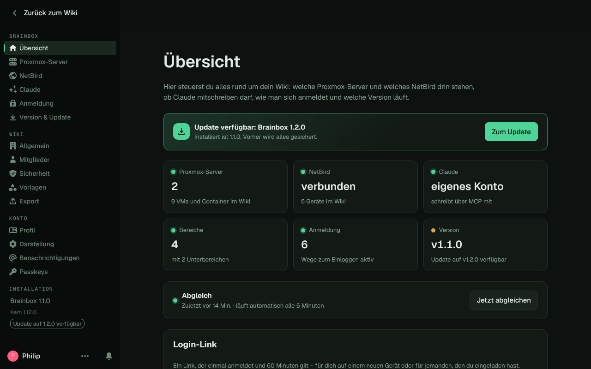</td>
    <td width="50%">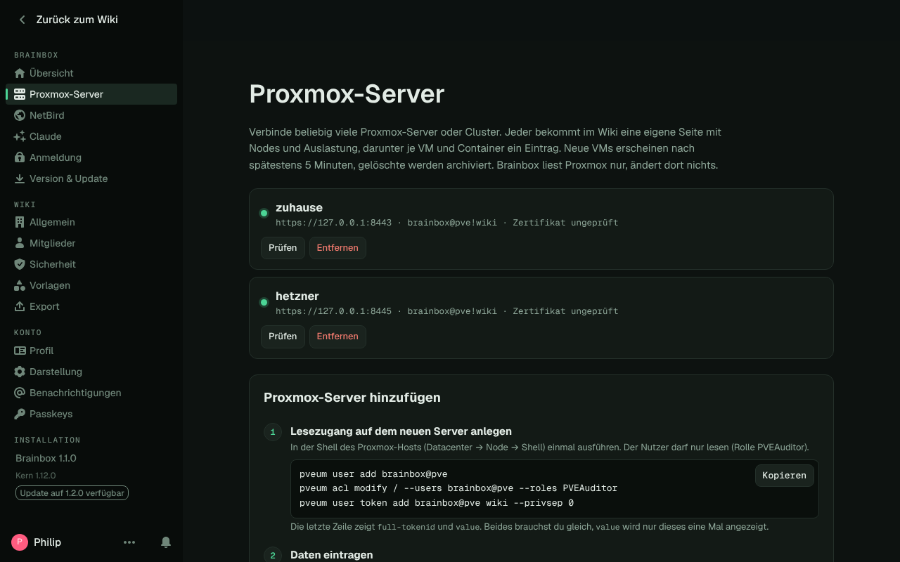</td>
  </tr>
  <tr>
    <td align="center"><sub>Übersicht: alles auf einen Blick, Abgleich, Login-Link</sub></td>
    <td align="center"><sub>Proxmox-Server: im selben Netz oder an anderen Standorten, prüfen, umbenennen</sub></td>
  </tr>
</table>

| Gruppe | Darin |
|---|---|
| **Brainbox** (nur Admins) | Übersicht · Proxmox-Server · NetBird · GitHub · Künstliche Intelligenz · Anmeldung · Version & Update |
| **Wiki** | Allgemein · Mitglieder · Sicherheit · Vorlagen · Export |
| **Konto** | Profil · Darstellung · Benachrichtigungen · Passkeys – auch mit einem Klick auf deinen Namen unten links |

Alle Seiten sehen gleich aus: Karten mit kurzer Erklärung, Schalter mit einem Satz dazu, was sie bewirken, und Hinweise, wo es weitergeht. Unter *Mitglieder* lädst du Leute ein, änderst Rollen oder sperrst Zugänge. Das Konto von Brainbox selbst (Automatik) ist markiert. *Vorlagen* legt auf Wunsch drei Beispiele an (Server-Steckbrief, Anleitung, Störung), *Export* packt das ganze Wiki als Markdown, HTML oder JSON zum Herunterladen.

<p align="center">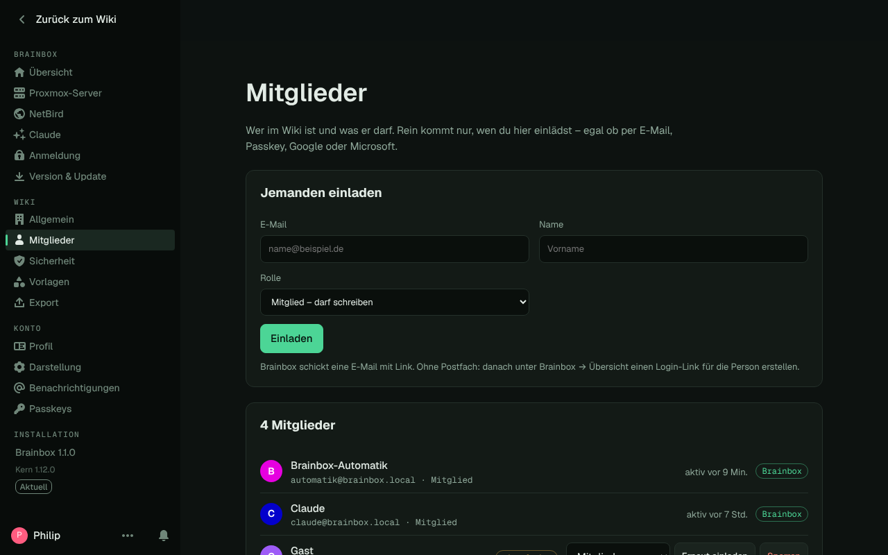</p>

Slack, Zapier, Webhooks, die GitHub-Integration des Editors, Analytics, Gruppen, Emojis, API-Schlüssel und Integrationen sind ausgeblendet – ein Homelab-Wiki braucht sie nicht. Alles aus der Gruppe *Brainbox* geht auch im Terminal des Containers: `brainbox-connect`, `brainbox-login`, `update`.

## 📖 Anleitung im Wiki

Nach der Installation liegt in der Sammlung **Start** eine kurze **Anleitung** (Aufbau, Schreiben, Finden, Homelab, Bereiche, Claude, Einladen, Update) und ein **Spickzettel** mit Tasten, Schreib-Kürzeln, „Wo was ist“ und den Befehlen im Container. Bei jedem Update frischt Brainbox beide auf – hast du sie selbst bearbeitet, bleiben sie, wie sie sind.

<p align="center">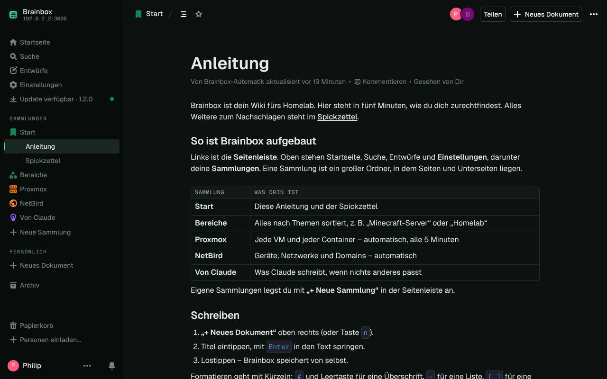</p>

## 🖥️ Proxmox-Server

Beliebig viele Server oder Cluster – zu Hause, im Keller, bei Hetzner. Jeder bekommt im Wiki eine eigene Seite mit Nodes, CPU, RAM und Laufzeit, darunter je VM und Container ein Eintrag mit Status, Ressourcen, IP-Adressen, Tags, NetBird-Gerät, Domains, Bereich und Link zurück zu Proxmox.

**Neuen Server verbinden** – unter *Einstellungen → Brainbox → Proxmox-Server* oder im Terminal:

```bash
# 1. auf dem neuen Proxmox-Host: Lesezugang anlegen (Rolle PVEAuditor)
pveum user add brainbox@pve
pveum acl modify / --users brainbox@pve --roles PVEAuditor
pveum user token add brainbox@pve wiki --privsep 0

# 2. im Brainbox-Container: verbinden
brainbox-connect proxmox add hetzner https://203.0.113.10:8006 'brainbox@pve!wiki' <value> --insecure
```

**Server an einem anderen Standort** – Brainbox kommt nicht heran (andere Firewall, kein VPN)? Dann meldet sich der Server selbst. Unter *Einstellungen → Brainbox → Proxmox-Server → Server an einem anderen Standort* einen Namen eintragen und den erzeugten Befehl einmal in der Shell des entfernten Proxmox-Hosts ausführen:

```bash
curl -fsSL https://brainbox.morncloud.de/zentrale/agent.sh | bash -s -- install https://brainbox.morncloud.de <Schlüssel>
```

Der kleine Brainbox-Agent liest dort alle 5 Minuten Nodes, VMs und Container (nur lesend, über `pvesh`) und schickt sie an deine Brainbox – ohne offene Ports. Von den VM-Einstellungen gehen nur Beschreibung, Betriebssystem, Name, Tags und Netzwerk mit, keine Passwörter oder SSH-Schlüssel. Im Terminal: `brainbox-connect proxmox agent NAME`. Entfernen auf dem Server: `brainbox-agent uninstall`.

**Umbenennen** – jederzeit, auch wenn der Server schon verbunden ist: in den Einstellungen bei jedem Server „Umbenennen“ oder `brainbox-connect proxmox rename proxmox-2 zuhause`. Die Wiki-Seiten bekommen den neuen Namen, Notizen und Links bleiben.

<table>
  <tr>
    <td width="50%">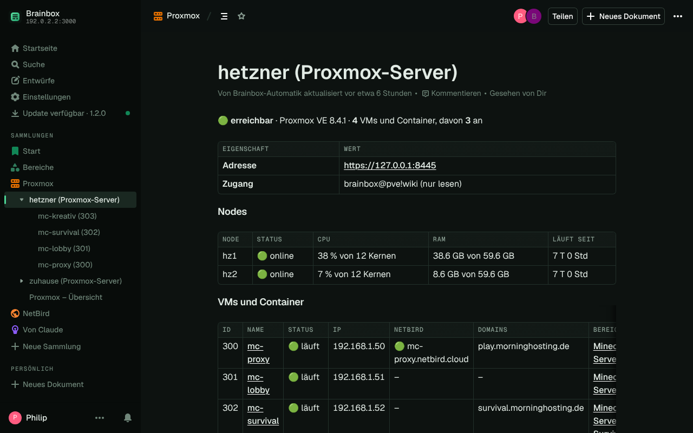</td>
    <td width="50%"></td>
  </tr>
  <tr>
    <td align="center"><sub>Server-Seite: Nodes, Auslastung, alle VMs und Container</sub></td>
    <td align="center"><sub>Ein Container mit NetBird-Gerät, Domain und Bereich</sub></td>
  </tr>
</table>

- **Neue VM:** steht nach spätestens 5 Minuten im Wiki (sofort mit `brainbox-connect sync`).
- **Gelöschte VM:** wird archiviert, nicht gelöscht. Kommt sie zurück, wird sie wiederhergestellt.
- **Server nicht erreichbar:** seine Einträge bleiben stehen, die Server-Seite zeigt den Grund.
- **Deine Notizen:** Alles ab der Überschrift „Notizen“ bleibt bei jedem Abgleich erhalten.

## 🌐 NetBird

Unter *Einstellungen → Brainbox → NetBird* (oder `brainbox-connect netbird`) API-Adresse und Access Token eintragen. Danach stehen alle Geräte im Wiki – online/offline, NetBird-IP, DNS-Name, Gruppen – plus eine Liste aller **Domains**: vom NetBird-**Reverse-Proxy** (Reverse Proxy → Services) mit Ziel, Status und Schutz (SSO, Passwort, nur NetBird …) und aus deinen NetBird-Netzwerken. Jede Domain landet über das Ziel des Dienstes bei der richtigen VM, sonst über gleichen Namen oder gleiche IP. Für den Reverse-Proxy braucht der Token die Rolle *Admin*. Passwörter und PINs der Dienste kommen nie ins Wiki.

## 🐙 GitHub

Unter *Einstellungen → Brainbox → GitHub* (oder `brainbox-connect github TOKEN`) einen GitHub-Token eintragen, der **nur lesen** darf: auf GitHub *Settings → Developer settings → Personal access tokens → Fine-grained tokens*, „All repositories“, *Contents: Read-only*. Ohne Token geht es auch – dann nur mit den öffentlichen Repos der Konten, die du einträgst (`brainbox-connect github --owners pmornhart`).

- **Je Repo eine Seite** in der Sammlung „GitHub“, sortiert nach Konto: Beschreibung, Sichtbarkeit, Art (Proxmox-Skript, Docker, Node.js …), **Was drin ist** und **Installieren** – aus dem README, sonst ein Vorschlag nach den Dateien im Repo. Darunter **Läuft auf**: welche VMs und Container aus dem Repo stammen.
- **Herkunft bei jeder VM:** Auf jeder VM-Seite und in der Proxmox-Übersicht steht, woher sie stammt:
  - **community-scripts** – erkannt am Tag `community-script` oder an der Beschreibung, die die Skripte in Proxmox hinterlassen, mit Link zum Skript
  - **eigenes Repo** – über einen GitHub-Link in der Proxmox-Beschreibung, eine Zeile `repo: besitzer/repo` dort oder weil die VM so heißt wie das Repo
  - **selbst festgelegt** – in den Zuordnungsregeln in der Tabelle *Muster | Herkunft*, z. B. `name:mc-*` → `MoinMornhart/minecraft-battleworld`
- **Sparsam:** README und Dateien liest Brainbox nur neu, wenn sich ein Repo geändert hat. Forks und archivierte Repos bleiben draußen, wenn du sie nicht dazunimmst.

<table>
  <tr>
    <td width="50%">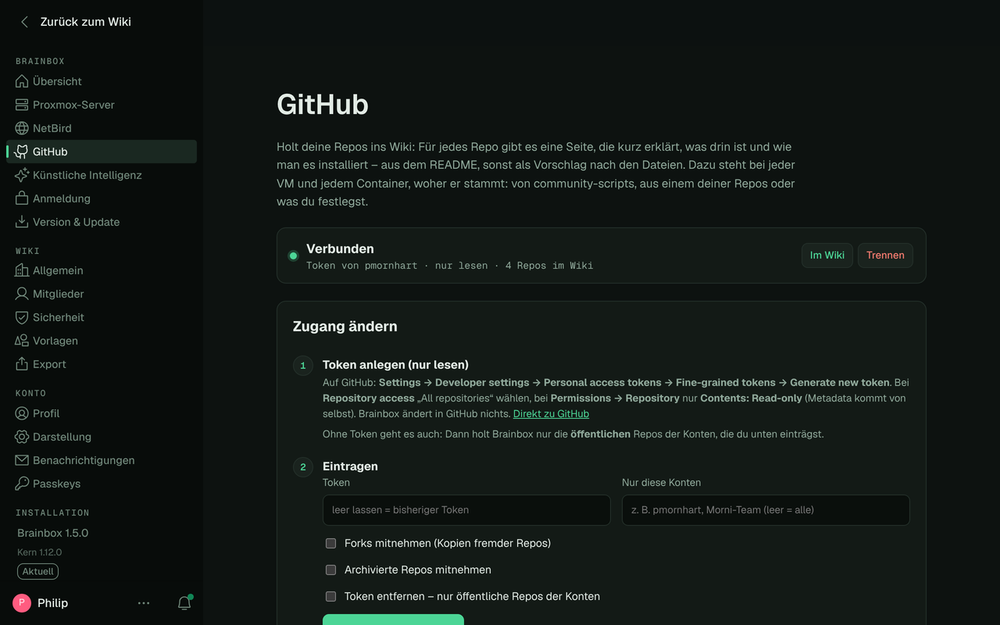</td>
    <td width="50%">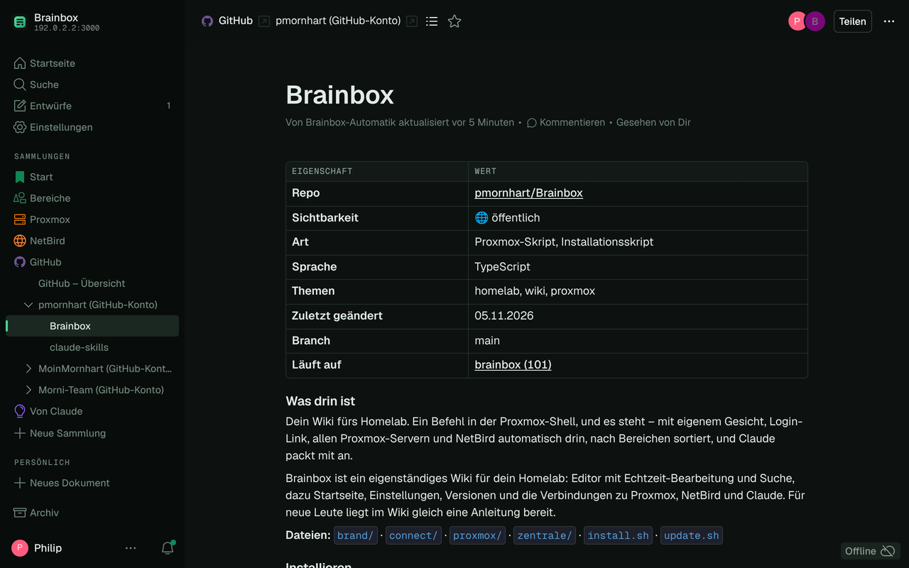</td>
  </tr>
  <tr>
    <td align="center"><sub>Einstellungen → GitHub</sub></td>
    <td align="center"><sub>Je Repo eine Seite: was drin ist, installieren, wo es läuft</sub></td>
  </tr>
</table>

## 🗂️ Bereiche

Die Seite **Zuordnungsregeln** in der Sammlung „Bereiche“ bearbeitest du direkt im Wiki:

| Muster | Bereich |
|---|---|
| `survival.morninghosting.de` | `Minecraft-Server/Survival` |
| `*.morninghosting.de` | `Minecraft-Server` |
| `tag:minecraft` | `Minecraft-Server` |
| `*.morncloud.de` | `Homelab` |
| `gruppe:Geräte` | `Geräte` |

Muster: Domains mit `*`, `name:mc-*` für Namen, `tag:` für Proxmox-Tags, `gruppe:` für NetBird-Gruppen. Die erste passende Regel gewinnt. `A/B` legt Unterbereiche an. Eine VM erbt den Bereich ihrer Domain, ein Gerät den seiner VM.

<table>
  <tr>
    <td width="50%">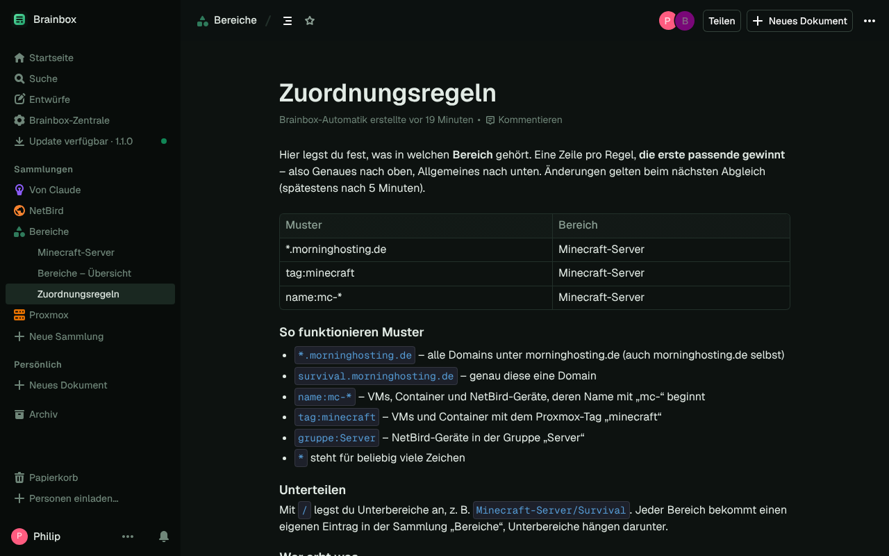</td>
    <td width="50%">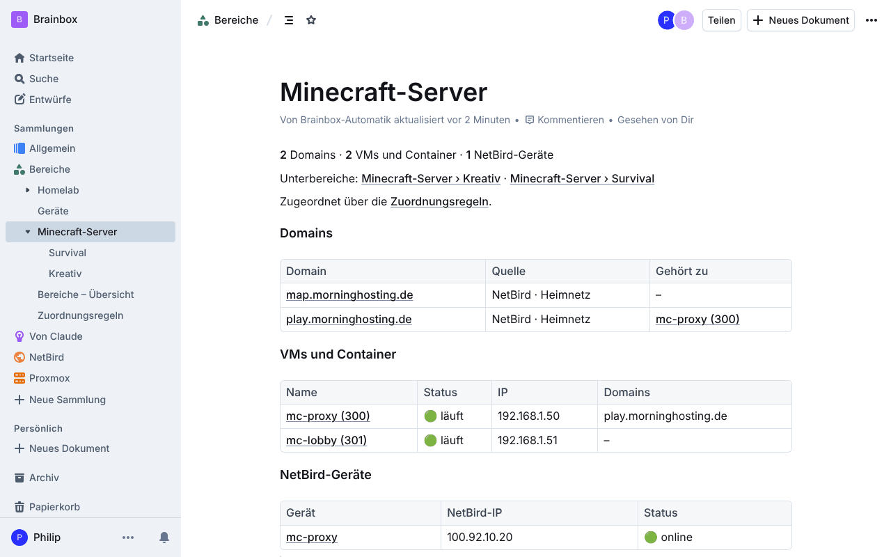</td>
  </tr>
</table>

## 🤖 Künstliche Intelligenz

Claude arbeitet direkt in deiner Brainbox – **mit deiner Anmeldung**, ohne eigenes Konto. Unter *Einstellungen → Brainbox → Künstliche Intelligenz* stehen Adresse und Anleitung (oder `brainbox-connect claude`).

- **Claude-App:** Einstellungen → Connectors → Benutzerdefinierten Connector hinzufügen → `https://brainbox.morncloud.de/mcp` → im Brainbox-Fenster anmelden und zulassen
- **Claude Code:** `claude mcp add --transport http brainbox https://brainbox.morncloud.de/mcp`, dann `/mcp` → anmelden

Claude kann dann im Wiki suchen, lesen und schreiben – und Brainbox bedienen (nur für Admins): Status abfragen, Proxmox-Server hinzufügen (im selben Netz oder an einem anderen Standort), umbenennen, prüfen, entfernen, NetBird verbinden, abgleichen, Updates einspielen. Beim Verbinden bekommt Claude eine Beschreibung von Brainbox mit: wie das Wiki aufgebaut ist, was der Abgleich überschreibt und wie man Server hinzufügt. Eigene Anweisungen (Ton, Vorlieben) trägst du auf derselben Seite ein. Ein Schalter dort sperrt KI-Zugriffe ganz.

Zum Beispiel: *„Füg meinen Proxmox in Frankfurt hinzu, an den kommt Brainbox nicht direkt ran.“* · *„Benenn proxmox-2 in zuhause um.“* · *„Welche Domains zeigen auf mc-proxy?“* · *„Gibt es ein Update? Dann spiel es ein.“*

<table>
  <tr>
    <td width="50%">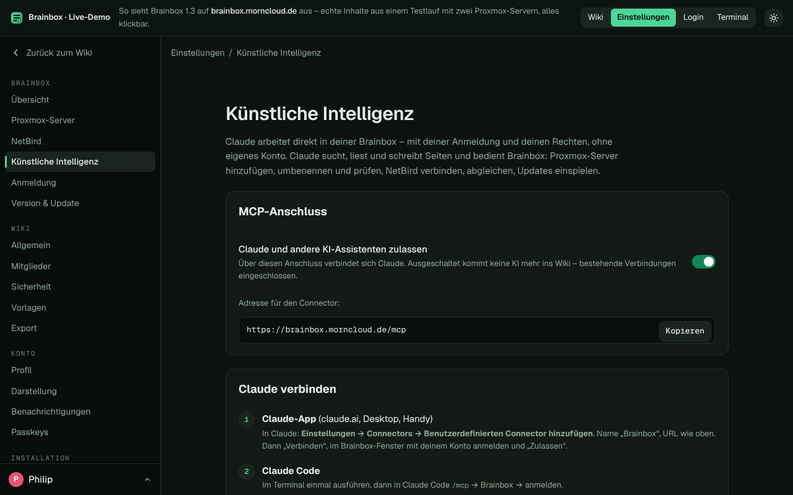</td>
    <td width="50%"></td>
  </tr>
  <tr>
    <td align="center"><sub>Künstliche Intelligenz: an/aus, Adresse, Anleitung, eigene Anweisungen</sub></td>
    <td align="center"><sub>Ein Eintrag, den Claude geschrieben hat</sub></td>
  </tr>
</table>

## 🔑 Anmelden

Unter *Einstellungen → Brainbox → Anmeldung* oder mit `brainbox-login`.

| Weg | Braucht |
|---|---|
| Login-Link | nichts – aus der Installation oder den Einstellungen |
| E-Mail | Postfach mit App-Passwort (Gmail, GMX, web.de …) |
| Passkey | HTTPS mit Domain |
| Google | OAuth-Client bei Google |
| Microsoft | App bei Microsoft Entra (Firmen- und Schulkonten) |
| Discord | App bei Discord |
| OIDC | eigener Login-Dienst (Pocket ID, Authentik …) |

Rein kommt nur, wer unter *Einstellungen → Wiki → Mitglieder* eingeladen ist – egal über welchen Weg.

<p align="center"></p>

## 🏷️ Versionen und Update

Brainbox hat eigene Versionen ([Änderungen](CHANGELOG.md)). Zu jeder gehört ein fest getesteter Wiki-Kern – in der Datei [`brainbox.version`](brainbox.version).

**Update-Symbol:** Brainbox sieht alle 6 Stunden selbst nach. Gibt es eine neue Version, erscheint oben in der Seitenleiste **„Update verfügbar“** und auf der Startseite ein Hinweis. Ein Klick führt zu *Einstellungen → Brainbox → Version & Update*, dort startet **Jetzt aktualisieren** das Update. Auch die Begrüßung im Terminal sagt Bescheid.

<p align="center">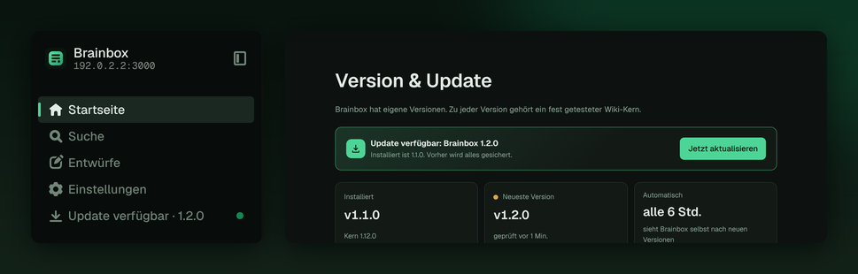</p>

**Update-Befehl** – im Container oder vom Proxmox-Host aus:

```bash
update                     # im Container: neueste Brainbox holen, Design anwenden, bauen, neu starten
pct exec <ID> -- update    # dasselbe vom Proxmox-Host aus
update --check             # nur nachsehen
```

Vorher sichert `update` Datenbank und Einstellungen nach `/root/brainbox-backups/`. Geht beim Bauen etwas schief, läuft automatisch wieder die alte Version. `brainbox-update` ist derselbe Befehl.

## 🧭 So hängt alles zusammen

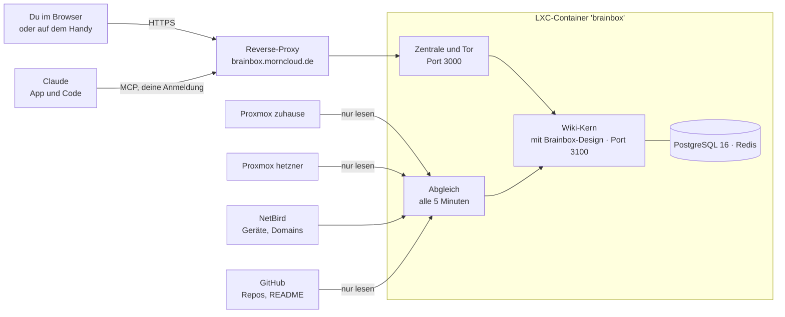

## 🧰 Befehle im Container

| Befehl | Wofür |
|---|---|
| `brainbox-connect` | Menü: Claude, Proxmox-Server, NetBird, GitHub, Abgleich |
| `brainbox-connect proxmox add NAME URL TOKEN-ID SECRET [--insecure]` | weiteren Proxmox-Server verbinden |
| `brainbox-connect proxmox list` / `remove NAME` / `test` | Server anzeigen, entfernen, prüfen |
| `brainbox-connect github TOKEN` / `--owners a,b` / `remove` | GitHub verbinden (Token nur lesen) bzw. nur öffentliche Repos; trennen |
| `brainbox-connect sync` | sofort abgleichen |
| `brainbox-connect start` | Anleitung im Wiki und Abgleich einrichten (machen Installation und Update von selbst) |
| `brainbox-login` | Anmeldewege einrichten |
| `brainbox-login link [E-Mail]` | einmaliger Login-Link, 60 Minuten |
| `update` (oder `brainbox-update`) | Brainbox aktualisieren, `--check` nur nachsehen |
| `pct exec <ID> -- update` | dasselbe vom Proxmox-Host aus |

<details>
<summary><b>Pfade und Ports</b></summary>

| Was | Wo |
|---|---|
| Zentrale und Tor zum Wiki | Port `3000` (Dienst `brainbox-zentrale`) |
| Wiki-Kern | Port `3100` (Dienst `brainbox`), `/opt/brainbox` |
| Brainbox-Bausatz (Design, Zentrale, Anleitung, Befehle) | `/opt/brainbox-kit` |
| Version | `/root/.brainbox`, letzte Update-Prüfung `/var/lib/brainbox/update.json` |
| Einstellungen des Kerns | `/opt/brainbox/.env` |
| Proxmox-Server | `/etc/brainbox/proxmox.json` (nur root) |
| Weitere Verbindungen und Schlüssel | `/etc/brainbox/connect.env` (nur root) |
| Hochgeladene Dateien | `/var/lib/outline/data` |
| Sicherungen | `/root/brainbox-backups/` |
| Logs | `journalctl -u brainbox`, `-u brainbox-zentrale`, `-u brainbox-sync` |

</details>

## 🔒 Sicherheit

- **Nur mit Einladung:** Die Installation schaltet „Einladungen erforderlich“ ein.
- **Brainbox-Einstellungen nur für Admins:** Die Zentrale prüft die Anmeldung im Wiki und nimmt Änderungen nur von der eigenen Seite an.
- **Proxmox nur lesen:** Zugang `brainbox@pve` mit Rolle PVEAuditor, eigener Token je Wiki. Der Agent an anderen Standorten liest nur per `pvesh`, schickt keine Passwörter oder SSH-Schlüssel mit und hat einen eigenen Schlüssel je Server – Brainbox speichert davon nur den Hash.
- **Claude nur mit deinen Rechten:** Claude meldet sich über den MCP-Anschluss mit deinem Konto an. Brainbox bedienen dürfen nur Admins; die Werkzeuge sprechen die Zentrale über einen internen Schlüssel an, der nur auf dem Container selbst gilt.
- **GitHub nur lesen:** Brainbox braucht nur *Contents: Read-only*. Der Token liegt in `/etc/brainbox/connect.env`, nie im Wiki.
- **Geheimnisse bleiben im Container:** Tokens und Schlüssel liegen nur für root lesbar in `/etc/brainbox/`, nie im Wiki.
- **Login-Links** gelten einmal und 60 Minuten.

## ❓ Häufige Fragen

<details><summary>Worauf baut Brainbox auf?</summary>

Der Wiki-Kern ist [Outline](https://github.com/outline/outline). Brainbox baut ihn bei jeder Installation und jedem Update aus dem Original-Release und legt sein eigenes Gesicht darüber: Name, Logo, Farben, Schrift, Startseite, Einstellungen, Anmeldeseite. Der Kern bleibt dabei aktualisierbar. Brainbox ist kein offizielles Outline-Produkt.
</details>

<details><summary>Kann ich mich mit einem privaten Outlook-Konto anmelden?</summary>

Über Microsoft nicht – das geht nur mit Firmen- und Schulkonten. Private Konten nehmen den E-Mail-Link oder einen Passkey.
</details>

<details><summary>Ich habe keinen Reverse-Proxy.</summary>

Domain bei der Installation leer lassen, dann läuft Brainbox im Heimnetz unter `http://IP:3000`. Passkeys, Google, Microsoft und die Claude-App brauchen später eine Domain mit HTTPS.
</details>

<details><summary>Die Einstellungen sagen „Nur für Admins“, obwohl ich Admin bin.</summary>

Das passierte bis 1.0.0 hinter manchen Reverse-Proxys, die die Adresse beim Weiterleiten auf die interne IP umschreiben. Ab 1.1.0 erkennt Brainbox sich auch an der Wiki-Adresse. Einmal im Container `update` ausführen (oder vom Proxmox-Host `pct exec <ID> -- update`), danach geht es auch über den Knopf in den Einstellungen. Steht danach etwas anderes da, nennt die Meldung jetzt den genauen Grund.
</details>

<details><summary>Geht es ohne Proxmox?</summary>

Ja, auf einem frischen Debian 13 als root. Dort fehlt meist `curl`, also zuerst:

```bash
apt-get update && apt-get install -y curl
```

Dann:

```bash
bash -c "$(curl -fsSL https://raw.githubusercontent.com/pmornhart/Brainbox/main/install.sh)"
```
</details>

## 🙏 Herkunft

Angefangen als Nachbau von [`ct/outline.sh`](https://github.com/community-scripts/ProxmoxVE/blob/main/ct/outline.sh) aus den [Proxmox VE Helper-Scripts](https://community-scripts.org/scripts/outline) (MIT, Autor: tremor021). Wiki-Kern: [outline/outline](https://github.com/outline/outline) (BSL 1.1). Schrift: [Geist](https://github.com/vercel/geist-font) (SIL OFL 1.1). Symbole: [Phosphor Icons](https://phosphoricons.com) (MIT, Zuordnung in `brand/symbole/`).

---

<sub>Verfasst mit Claude 🤖</sub>
